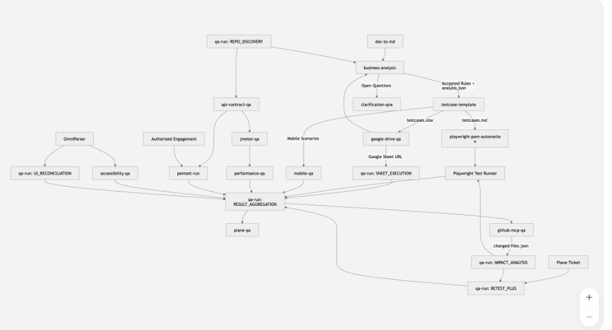

# QA-skill

Bộ skill QA và Security Engineering đa model cho **QA team** (MIT), dùng được với Codex, Claude Code, Gemini/Antigravity, Cursor, Windsurf và Copilot.

## 16 skill

| Skill | Mục đích | Đầu ra |
|---|---|---|
| [qa-run](./qa-run/SKILL.md) | Săn bug exploratory + log Plane + đóng gói evidence (PDF/Drive) | `FINDINGS.md` + ticket Plane + ảnh |
| [testcase-template](./testcase-template/SKILL.md) | Sinh test case Excel theo template Nina Studio (4 sheet, formulas, dropdowns) | `Template.xlsx` |
| [playwright-pom-automation](./playwright-pom-automation/SKILL.md) | Scaffold & viết Playwright + TS + POM (UI / API / Performance / CI-CD) | `.spec.ts` + `pages/` + `selectors/` + pipeline |
| [doc-to-md](./doc-to-md/SKILL.md) | Convert PDF/DOCX/PPTX/XLSX sang Markdown bằng MarkItDown (Microsoft) | `.md` files |
| [business-analysis](./business-analysis/SKILL.md) | Phân tích business như senior fullstack QA/QC, dựng flow và Q&A | `.xmind` + Q&A `.md` + `.xlsx` |
| [pentest-run](./pentest-run/SKILL.md) | Điều phối pentest được ủy quyền từ scope, recon đến validation và report | engagement contract + evidence + findings |
| [plane-qa](./plane-qa/SKILL.md) | CRUD ticket Plane đa workspace, log bug, comment retest và evidence inline | ticket/comment Plane |
| [google-drive-qa](./google-drive-qa/SKILL.md) | CRUD Drive, Docs, Sheets, Slides và permissions qua MCP | file/folder/report trên Drive |
| [data-quality-qa](./data-quality-qa/SKILL.md) | Database, ETL/ELT, reconciliation, lineage và schema drift | data-quality evidence |
| [ai-quality-qa](./ai-quality-qa/SKILL.md) | LLM, RAG, agent, structured output, safety và regression | eval dataset + report |
| [accessibility-qa](./accessibility-qa/SKILL.md) | WCAG 2.2, axe, keyboard và screen reader | accessibility evidence |
| [performance-qa](./performance-qa/SKILL.md) | Một orchestrator cho JMeter/k6, common config, threshold, report và bottleneck | `.jmx`/k6 + JSON/Markdown/HTML report |
| [api-contract-qa](./api-contract-qa/SKILL.md) | OpenAPI/Postman/GraphQL/gRPC contract verification | contract evidence |
| [postman](./postman/SKILL.md) | Tự cấu hình OAuth MCP và vận hành workspace/collection/spec Postman | Postman MCP connection + verified operation |
| [mobile-qa](./mobile-qa/SKILL.md) | Android/iOS, device matrix và Appium | mobile QA evidence |
| [github-mcp-qa](./github-mcp-qa/SKILL.md) | GitHub MCP, repository, PR, Issues và Actions CI/CD | MCP config + verified operation |

## 🗺️ Master Skill Architecture & Flow Diagram



Sơ đồ luồng & mapping chi tiết giữa các skill: [SKILL_FLOW_MAPPING.md](./SKILL_FLOW_MAPPING.md)

Hướng dẫn cài đặt, cấu hình công cụ và ví dụ sử dụng security skill: [PENTEST-RUN-GUIDE.md](./PENTEST-RUN-GUIDE.md)

Hướng dẫn dùng skill performance cho JMeter/k6: [performance-qa/GUIDE.md](./performance-qa/GUIDE.md)

Hướng dẫn phân biệt skill với MCP và kết nối QA MCP stack: [qa-mcp-stack-vi.md](./github-mcp-qa/references/qa-mcp-stack-vi.md)

## Cross-model compatibility

Mọi agent đọc router và hard gate trong [AGENTS.md](./AGENTS.md). Gemini/Antigravity đọc bản mirror [GEMINI.md](./GEMINI.md).

Kiểm tra contract trước khi dùng hoặc push:

```bash
python3 scripts/validate_cross_model.py
```

Evaluation cases và pass criteria nằm trong [MODEL-COMPATIBILITY.md](./MODEL-COMPATIBILITY.md).

## Cài đặt (máy mới)

```bash
# 1. Clone
git clone git@github.com:tqphong02/QA-skill.git
cd QA-skill

# 2a. Codex
./scripts/setup.sh --agent=codex --profile=core --yes

# 2b. Antigravity
./scripts/setup.sh --agent=antigravity --profile=core --yes

# 2c. Claude Code
./scripts/setup.sh --agent=claude --profile=core --yes

# Cài đủ 16 skill chuyên sâu khi cần
./scripts/setup.sh --agent=antigravity --profile=full --yes

# Chỉ cài Postman skill + tự merge MCP config
./scripts/setup.sh --agent=antigravity --only=postman --skip-deps --yes

# Cấp đúng 1 skill cho intern, không kèm nested/vendor skill
./scripts/setup.sh --agent=codex --only=qa-run --skip-deps --yes

# 3. Export Plane API key trước khi mở agent
export PLANE_API_KEY="plane_pat_xxx"

# 4. Google Drive MCP: dùng OAuth Desktop credential đã có
codex mcp add google-drive \
  --env GOOGLE_DRIVE_OAUTH_CREDENTIALS="$HOME/.config/google-drive-mcp/gcp-oauth.keys.json" \
  --env GOOGLE_DRIVE_MCP_SCOPES="drive,drive.file,documents,spreadsheets,presentations" \
  -- npx -y @piotr-agier/google-drive-mcp

# 5. GitHub MCP cho Codex dùng PAT từ environment, không ghi token vào repo
# Export GITHUB_PAT_TOKEN bằng secret manager hoặc terminal hiện tại trước bước này
bash github-mcp-qa/scripts/install-codex.sh

# 6. Kiểm tra host và QA MCP stack
bash scripts/doctor-agent.sh --agent=codex
bash github-mcp-qa/scripts/doctor-stack.sh --agent=codex
```

Windows PowerShell:

```powershell
.\scripts\setup.ps1 -Agent codex -Profile core -Yes
.\scripts\setup.ps1 -Agent antigravity -Profile core -Yes
.\scripts\setup.ps1 -Agent claude -Profile core -Yes
.\scripts\setup.ps1 -Agent antigravity -Profile full -Yes
```

Không commit Plane API key, OAuth credential hoặc token. Có thể tạo profile định tuyến cục bộ từ `plane-qa/ACCOUNT-PROFILE.example.md` và `google-drive-qa/ACCOUNT-PROFILE.example.md`.

Với Postman trên Antigravity, setup tự thêm hoặc bật `mcpServers.postman` trong global config và giữ nguyên các MCP khác. Sau setup, restart Antigravity, chạy `/mcp` và đăng nhập Postman qua OAuth; không cần nhập API key hoặc sửa JSON

Google Drive MCP lần đầu cần cấu hình Google Cloud project, APIs, Audience, scopes và OAuth Desktop client theo [GOOGLE_CLOUD_OAUTH_SETUP.md](./google-drive-qa/references/GOOGLE_CLOUD_OAUTH_SETUP.md)

Xem [SETUP-GUIDE.md](./SETUP-GUIDE.md) và [WINDOWS-SETUP.md](./WINDOWS-SETUP.md). GitHub MCP có guide riêng cho [Codex](./github-mcp-qa/references/codex-github-mcp-vi.md) và [Antigravity](./github-mcp-qa/references/antigravity-github-mcp-vi.md)

## API Keys (cho AI models)

Bộ skill này dùng AI model (Claude, GPT, Gemini) cho một số tác vụ (vd testcase-template có thể dùng AI để suggest test cases). Hỗ trợ 3 cách config:

**Cách 1: Dùng môi trường free (KHÔNG cần API key)**

| Môi trường | Cách detect |
|---|---|
| GitHub Copilot Pro | Tự detect qua env `COPILOT_PRO` hoặc `GITHUB_COPILOT_TOKEN` |
| Google Antigravity | Tự detect qua env `ANTIGRAVITY_API_KEY` hoặc app `/Applications/Antigravity.app` |
| Claude Code CLI | Tự detect qua env `ANTHROPIC_API_KEY` |

**Cách 2: Config API key vào `config/api_keys.json` (gitignored)**

```bash
# 1. Copy template
cp config/api_keys.example.json config/api_keys.json

# 2. Edit file, paste key thật
nano config/api_keys.json

# 3. Verify provider đang dùng
python3 scripts/ai_provider.py
```

**Cách 3: Env var (ưu tiên cao nhất)**

```bash
export ANTHROPIC_API_KEY="sk-ant-..."
export OPENAI_API_KEY="sk-..."
export GOOGLE_API_KEY="AIza..."
export PLANE_API_KEY="plane_pat_..."
```

### Helper module

`scripts/ai_provider.py` — tự detect môi trường và load key:

```python
from scripts.ai_provider import (
    get_anthropic_client,    # Returns anthropic.Anthropic or None
    get_openai_client,       # Returns openai.OpenAI or None
    get_google_client,       # Returns google.generativeai or None
    get_provider_info,       # Returns dict với status
    detect_environment,      # 'antigravity' | 'copilot_pro' | 'claude_code' | 'standalone'
)

info = get_provider_info()
# {'environment': 'antigravity', 'active_provider': 'Antigravity (Gemini - free)', ...}
```

## License

MIT — xem [LICENSE](./LICENSE).
