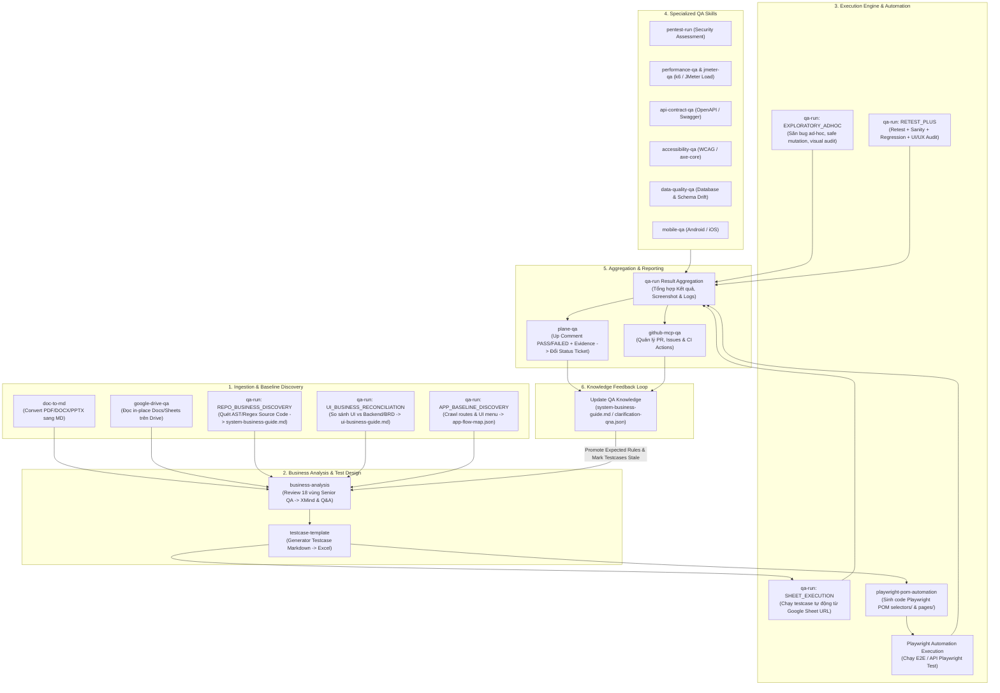

# QA-skill — Hướng dẫn Chi tiết Luồng & Mapping giữa 16 Skills

Tài liệu này ghi lại toàn bộ sơ đồ kiến trúc, luồng chuyển giao dữ liệu (Data Handover), router cố định và 6 quy trình thực thi thực tế giữa **16 Skills** trong hệ thống **QA-skill Framework**.

---

## 🎯 1. Triết lý Thiết kế Tinh gọn (Lean QA Architecture)

QA-skill được xây dựng theo kiến trúc tinh gọn (**Lean QA Architecture**):
- **Deterministic Script-First**: Ưu tiên chạy script Node.js / Python / Playwright CLI trực tiếp để tiết kiệm Token và đạt tốc độ thực thi sub-second.
- **Filesystem Knowledge Hub**: Lưu trữ kiến thức dưới dạng Markdown & JSON cục bộ trong `qa-knowledge/` giúp AI đọc lại nhanh và tái sử dụng giữa các phiên làm việc.
- **Single Source of Truth**: Một file JSON duy nhất sinh ra đồng bộ cả XMind, Q&A Markdown và Q&A Excel.

---

## 🗺️ 2. Sơ đồ Luồng Tổng thể (Master Flow Diagram)



---

## 📊 3. Ma trận Chuyển giao giữa 16 Skills (Data Handover Matrix)

| Skill Nguồn (Input) | Luồng Xử lý (Process) | Output Sinh ra (Artifact) | Skill Tiếp nhận (Consumer) | Dữ liệu Chuyển giao |
|:---|:---|:---|:---|:---|
| **`doc-to-md`** | Convert PDF/DOCX/PPTX/HTML sang Markdown | File `.md` chuẩn heading/table | `business-analysis` | Nội dung tài liệu yêu cầu dạng text |
| **`google-drive-qa`** | Đọc/Ghi remote Docs, Sheets, Slides qua MCP | Dữ liệu văn bản / bảng remote | `business-analysis`<br>`qa-run` | SRS/BRD hoặc danh sách Testcase từ Google Drive |
| **`qa-run`** *(REPO_DISCOVERY)* | Quét AST/Regex 14 scripts từ Source Code | `system-business-guide.md`<br>`system-qna.json` | `business-analysis`<br>`qa-run` | Kiến trúc hệ thống, API contracts, State machines, Rules |
| **`qa-run`** *(UI_RECONCILIATION)* | So sánh UI với Code & Docs 13 bước | `ui-business-guide.md`<br>`clarification-qna.json` | `testcase-template`<br>`business-analysis` | Mâu thuẫn UI vs Backend/BRD, Q&A cho BA/PO/Dev |
| **`qa-run`** *(APP_DISCOVERY)* | Crawl routes, menu & components | `app-flow-map.json`<br>`app-business-guide.md` | `qa-run` | Bản đồ bao phủ (Coverage map) toàn bộ ứng dụng |
| **`business-analysis`** | Phân tích Senior QA 18 vùng nghiệp vụ | `analysis.json`<br>`file.xmind`<br>`Q&A MD + Excel` | `testcase-template` | Flow nghiệp vụ đã xác minh, Mindmap & Q&A answers |
| **`testcase-template`** | Generator sinh Testcase | `testcases.md` (trước)<br>`testcases.xlsx` (sau) | `playwright-pom-automation`<br>`qa-run` | Danh sách Testcases chuẩn schema (ID, Steps, Expected) |
| **`playwright-pom-automation`** | Scaffold dự án Playwright POM | `selectors/`, `pages/`, `tests/` | Trình thực thi Playwright | Mã nguồn tự động hóa Playwright E2E / API |
| **`qa-run`** *(SHEET_EXECUTION)* | Đọc Sheet URL & chạy Playwright CLI | Result + Screenshots | `qa-run Aggregation` | Kết quả thực thi testcase hàng loạt từ Google Sheet |
| **`qa-run`** *(RETEST_PLUS)* | Chạy 5 bước retest chuyên sâu | `run-manifest.json`<br>`evidence/` screenshots | `plane-qa` | Trạng thái PASS/FAILED/BLOCKED, evidence screenshot crop |
| **`pentest-run`** | Authorized Security Assessment | `.pentest/engagement.md`<br>Security Findings | `plane-qa`<br>`qa-run Aggregation` | Lỗi bảo mật IDOR, SSRF, SSTI, JWT, GraphQL, Race Condition |
| **`performance-qa`** / **`jmeter-qa`** | Load & Stress Testing bằng k6 / JMeter | `performance-report.json`<br>File `.jmx` | `qa-run Aggregation` | Chỉ số p95 latency, RPS, error rate, bottleneck |
| **`api-contract-qa`** | Validate OpenAPI / Swagger / Postman | `contract-report.json` | `qa-run Aggregation` | Sai khác giữa API spec và implementation thực tế |
| **`accessibility-qa`** | Web Accessibility Audit (axe-core / WCAG) | `a11y-report.json` | `qa-run Aggregation` | Lỗi vi phạm WCAG, keyboard focus, screen reader |
| **`data-quality-qa`** | Database ETL & Schema Drift check | `data-drift.json` | `qa-run Aggregation` | Bảng dữ liệu lệch schema, data lineage error |
| **`mobile-qa`** | Appium testing trên Android / iOS | `mobile-report.json` | `qa-run Aggregation` | Kết quả test ứng dụng di động APK / IPA |
| **`plane-qa`** | CRUD Plane Tickets & Comments | Comment retest + Đổi Ticket Status | `github-mcp-qa` | PASS → `Done`, FAILED → `In Progress`, Bug mới → `Todo` |
| **`github-mcp-qa`** | Đọc Git diff/PR, quản lý Issues & Actions | PR Comment + CI Check Status | `qa-run` | Nhận biết changed files để chọn testcases bị ảnh hưởng |

---

## 📋 4. Router Cố định & Quy tắc Kích hoạt (Fixed Router)

| Tín hiệu yêu cầu (User Prompt / Trigger) | Skill được kích hoạt | Hành động đầu tiên của AI Agent |
|:---|:---|:---|
| **Plane URL, Ticket ID, log bug, comment PASS/FAILED/BLOCKED** | `plane-qa` | Parse URL → Chạy `scripts/doctor.sh` → `post-result.py` |
| **Retest, re-test, verify bug/ticket** | `plane-qa` + `qa-run` | Plane doctor/read → Kích hoạt **RETEST_PLUS** (Retest flow gốc + Sanity + Impacted Regression + Exploratory + UI/UX Audit) |
| **"Test thử trang này, chưa có testcase..." / Săn bug ad-hoc** | `qa-run: EXPLORATORY_ADHOC` | Đọc knowledge có sẵn → Sinh dynamic checklist → Safe mutation → Visual audit → Log bug |
| **"Học toàn bộ web app này..." / Bootstrap app baseline** | `qa-run: APP_BASELINE_DISCOVERY` | Quét menu, route, API → Lưu `app-flow-map.json` & `app-business-guide.md` với `coverage_map` |
| **Chạy execution testcase từ Google Sheet URL** | `qa-run: SHEET_EXECUTION` | Chạy `execute-sheet.mjs --parallel` → Thực thi Playwright → Ghi kết quả + screenshot vào Sheet |
| **Phân tích repo, học business flow từ source code** | `qa-run: REPO_BUSINESS_DISCOVERY` | Chạy `repo-business-discovery.mjs --repo <path> --mode full` → Merge vào `system-business-guide.md` & `system-qna.json` |
| **Từ UI suy ra flow, đối chiếu Code + Docs + Runtime, tìm mâu thuẫn** | `qa-run: UI_BUSINESS_RECONCILIATION` | Chạy `ui-business-reconciliation.mjs --page <slug>` → Phân loại 9 kết quả, 10 ambiguity patterns → Xuất `ui-business-guide.md` & `clarification-qna.json` |
| **Viết/sửa/review testcase, Scenario ID/Name** | `testcase-template` | Đọc testcase Markdown cũ nếu có → Generator tạo Markdown trước, Excel sau |
| **Viết Playwright automation / POM code (`selectors/`, `pages/`)** | `playwright-pom-automation` | Đọc template POM → Scaffold cấu trúc `selectors/`, `pages/`, `tests/` |
| **Phân tích BRD/SRS, dựng flow hệ thống, tạo XMind hoặc Q&A** | `business-analysis` (+ `doc-to-md` khi nguồn chưa là MD) | Convert đính kèm sang MD → Review 18 vùng Senior QA → Generate XMind + Q&A Markdown + Q&A Excel |
| **Pentest được ủy quyền, security assessment, IDOR, SSRF, JWT...** | `pentest-run` | Đọc `.pentest/engagement.md` → Chạy `scripts/doctor.sh` trước request mạng |
| **Performance, load, stress test, k6, Chrome DevTools** | `performance-qa` / `jmeter-qa` | Xác nhận workload contract → Generate JMX / Script k6 |
| **OpenAPI, Swagger, Postman contract validation** | `api-contract-qa` | Validate spec đối chiếu với implementation thực tế |
| **WCAG, axe-core, keyboard access, screen reader** | `accessibility-qa` | Kết hợp automated scan với manual interaction |
| **ETL/ELT, reconciliation, database schema drift** | `data-quality-qa` | Xác nhận nguồn/đích & read-only boundary tại DB role |

---

## 🛠️ 5. Chi tiết 6 Quy trình Thực tế (End-to-End Use Cases)

### 1️⃣ Flow 1: System Baseline Discovery (Học Hệ thống từ Source Code)
```text
Source Code Repository
  └─► qa-run (REPO_BUSINESS_DISCOVERY)
       ├─► 14 AST & Regex Extractor Scripts
       ├─► Trích xuất: API Contracts, State Machines, Permission Matrix, Domain ERD, Business Rules
       └─► Merge xuất ra: qa-knowledge/merged/system-business-guide.md & system-qna.json
```

### 2️⃣ Flow 2: UI Business Reconciliation (Phân tích Mâu thuẫn UI vs Backend/BRD)
```text
Live Page URL / DOM Snapshot
  └─► qa-run (UI_BUSINESS_RECONCILIATION)
       ├─► Step 1: Component Extraction (data-testid > aria-label > role + name > id > CSS)
       ├─► Step 2: Region Segmentation (Header, Sidebar, Toolbar, Form, Table, Modal)
       ├─► Step 3: Safe Multi-State Explorer (Action Safety Guard, Normalized State Hash)
       ├─► Step 4: Runtime Transition Verifier (Reload persistence check, Redaction)
       ├─► Step 5: 3-Angle Reconciliation (Actual UI vs Implemented Code vs Expected BRD)
       ├─► Step 6: 10 Ambiguity Patterns & Clarification Q&A Lifecycle
       └─► Output: ui-business-guide.md & clarification-qna.json
```

### 3️⃣ Flow 3: Requirements to Testcase & XMind (Tài liệu -> Mindmap & Testcases)
```text
File SRS/BRD (PDF/Drive)
  └─► doc-to-md / google-drive-qa
       └─► business-analysis (Review 18 vùng Senior QA)
            ├─► Sinh file JSON trung tâm: analysis.json
            └─► Chạy generate.sh sinh 3 output đồng bộ 100%:
                 ├── 1. file.xmind (Sơ đồ tư duy editable + Mũi tên liên kết thực)
                 ├── 2. clarification-qna.md (Bảng Q&A cho AI/QA đọc)
                 └── 3. clarification-qna.xlsx (File Excel gửi BA/PO điền trả lời)
            └─► testcase-template (Sinh testcases.md & testcases.xlsx)
```

### 4️⃣ Flow 4: Google Sheet Test Execution (Chạy Test từ Sheet URL)
```text
Google Sheet URL chứa Testcases
  └─► qa-run (SHEET_EXECUTION)
       ├─► Chạy execute-sheet.mjs --parallel
       ├─► Trình duyệt Playwright đọc các bước action & expected result
       ├─► Bắt Screenshot Evidence cho mỗi bước
       └─► Cập nhật trực tiếp trạng thái PASS / FAILED kèm link ảnh vào Google Sheet
```

### 5️⃣ Flow 5: Retest Bug Lifecycle (`RETEST_PLUS` -> Plane Update)
```text
Nhận Ticket URL (Plane)
  └─► plane-qa (Parse URL -> Doctor check quyền)
       └─► qa-run (RETEST_PLUS)
            ├── 1. Retest flow gốc gây ra lỗi
            ├── 2. Smoke/Sanity check các tính năng xung quanh
            ├── 3. Impacted Regression (Kiểm tra vùng ảnh hưởng)
            ├── 4. Exploratory & Ad-hoc (Săn bug ngoài flow)
            └── 5. UI/UX Visual Audit (Soi lệch layout / CSS)
       └─► plane-qa (Post Result & Evidence)
            ├── PASS   ──► Đổi trạng thái Ticket sang "Done" + Comment bằng chứng
            ├── FAILED ──► Đổi trạng thái Ticket sang "In Progress" + Comment lỗi
            └── BLOCKED ─► Giữ nguyên trạng thái + Comment lý do bị kẹt
```

### 6️⃣ Flow 6: Playwright POM Automation Engineering
```text
testcases.md (Bộ testcases chuẩn)
  └─► playwright-pom-automation
       ├─► Tách selectors đặt vào selectors/<page>.json
       ├─► Viết Page Object class vào pages/<page>.page.mjs
       ├─► Tạo test spec vào tests/<feature>.spec.mjs (gắn tag @ui, @api, @functional)
       └─► Thực thi tự động qua Playwright Test Runner & wire Allure report
```

---

## 🗄️ 6. Cấu trúc Thư mục Knowledge (`qa-knowledge/`)

Tất cả kiến thức thu thập được lưu giữ nhất quán dưới dạng **Markdown & JSON**:

```text
qa-knowledge/
  ├── merged/
  │   ├── system-business-guide.md   # Hợp nhất toàn bộ kiến trúc & rules từ Source Code
  │   └── system-qna.json             # Bộ Q&A trích xuất từ source code
  ├── ui-business/                    # Kết quả phân tích UI vs Backend/BRD theo từng trang
  │   └── <page-slug>/
  │       ├── ui-business-guide.md    # Hướng dẫn nghiệp vụ UI 12 phần
  │       ├── business-conflicts.json # Danh sách mâu thuẫn & deep evidence bundle
  │       ├── transition-evidence.json# Bằng chứng transition & reload persistence
  │       ├── clarification-qna.json  # Câu hỏi Q&A phân định BA/PO/Dev
  │       └── ui-state-graph.json     # Sơ đồ chuyển trạng thái UI đã mã hóa
  ├── app-business-guide.md           # Baseline coverage map tổng thể ứng dụng
  ├── testcases/                      # File Testcase Markdown & Excel
  └── evidence/                       # Screenshots crop & network logs theo phiên test
```

---

## 🔄 7. Vòng Phản hồi Tinh gọn (Simple Knowledge Feedback Loop)

```text
QA phát hiện Rule nghiệp vụ mới / Mâu thuẫn UI
  │
  ▼
clarification-qna.json (Tạo Q&A với SHA256 Fingerprint)
  │
  ▼
BA / PO xác nhận trả lời (Chuyển status -> ACCEPTED)
  │
  ▼
Update QA Knowledge:
  ├─► Promote câu trả lời thành Expected Rule vào resolved-business-rules.json
  ├─► Cập nhật system-business-guide.md & ui-business-guide.md
  └─► Đánh dấu STALE trên các testcases liên quan → Tự động sinh lại Testcase Excel/Markdown chuẩn nhất
```
