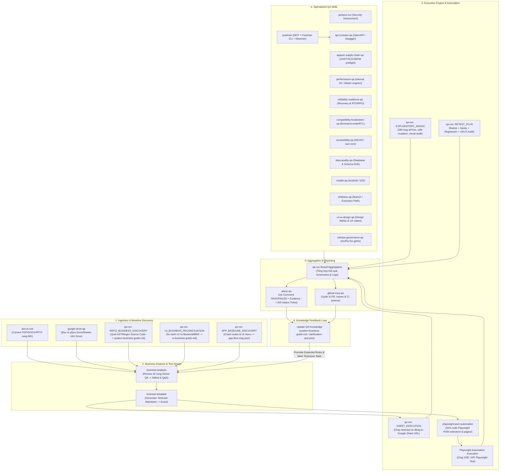
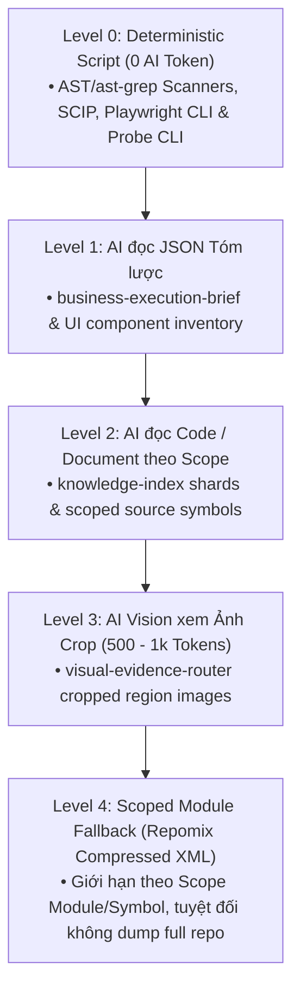
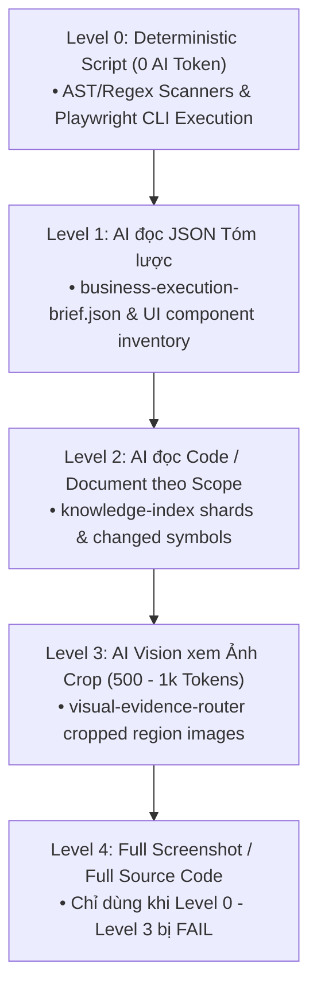

# QA-skill — Hướng dẫn Chi tiết Luồng & Mapping giữa 23 Skills

Tài liệu này ghi lại toàn bộ sơ đồ kiến trúc, luồng chuyển giao dữ liệu (Data Handover), router cố định và 6 quy trình thực thi thực tế giữa **23 Skills** trong hệ thống **QA-skill Framework**.

---

## 🎯 1. Triết lý Thiết kế Tinh gọn (Lean QA Architecture)

QA-skill được xây dựng theo kiến trúc tinh gọn (**Lean QA Architecture**):
- **Deterministic Script-First**: Ưu tiên chạy script Node.js / Python / Playwright CLI trực tiếp để tiết kiệm Token và đạt tốc độ thực thi sub-second.
- **Filesystem Knowledge Hub**: Lưu trữ kiến thức dưới dạng Markdown & JSON cục bộ trong `qa-knowledge/` giúp AI đọc lại nhanh và tái sử dụng giữa các phiên làm việc.
- **Single Source of Truth**: Một file JSON duy nhất sinh ra đồng bộ cả XMind, Q&A Markdown và Q&A Excel.

---

## 🗺️ 2. Sơ đồ Luồng Tổng thể (Master Flow Diagram)



---

## 📊 3. Ma trận Chuyển giao giữa 23 Skills (Data Handover Matrix)

| Skill Nguồn (Input) | Luồng Xử lý (Process) | Output Sinh ra (Artifact) | Skill Tiếp nhận (Consumer) | Dữ liệu Chuyển giao |
|:---|:---|:---|:---|:---|
| **`doc-to-md`** | Convert PDF/DOCX/PPTX/HTML sang Markdown | File `.md` chuẩn heading/table | `business-analysis` | Nội dung tài liệu yêu cầu dạng text |
| **`google-drive-qa`** | Đọc/Ghi remote Docs, Sheets, Slides qua MCP | Dữ liệu văn bản / bảng remote | `business-analysis`<br>`qa-run` | SRS/BRD hoặc danh sách Testcase từ Google Drive |
| **`qa-run`** *(REPO_DISCOVERY)* | Quét AST/Regex 14 scripts từ Source Code | `system-business-guide.md`<br>`system-qna.json` | `business-analysis`<br>`qa-run` | Kiến trúc hệ thống, API contracts, State machines, Rules |
| **`qa-run`** *(UI_RECONCILIATION)* | Map live UI/snapshot với requirement registry và evidence | `ui-requirement-traceability.json`<br>`ui-business-guide.md`<br>`clarification-qna.json` | `testcase-template`<br>`business-analysis` | UI item ↔ Requirement ID ↔ Doc/Source/Runtime evidence và Q&A cho BA/PO/Dev |
| **`qa-run`** *(APP_DISCOVERY)* | Crawl routes, menu & components | `app-flow-map.json`<br>`app-business-guide.md` | `qa-run` | Bản đồ bao phủ (Coverage map) toàn bộ ứng dụng |
| **`business-analysis`** | Phân tích Senior QA 18 vùng nghiệp vụ | `analysis.json`<br>`file.xmind`<br>`Q&A MD + Excel`<br>`.business-analysis/*_Requirements.json` | `testcase-template`<br>`qa-run UI_RECONCILIATION` | Flow, Q&A và atomic requirement có stable ID/source_ref cho browser mapping |
| **`testcase-template`** | Generator sinh Testcase | `testcases.md` (trước)<br>`testcases.xlsx` (sau) | `playwright-pom-automation`<br>`qa-run` | Danh sách Testcases chuẩn schema (ID, Steps, Expected) |
| **`playwright-pom-automation`** | Scaffold dự án Playwright POM | `selectors/`, `pages/`, `tests/` | Trình thực thi Playwright | Mã nguồn tự động hóa Playwright E2E / API |
| **`qa-run`** *(SHEET_EXECUTION)* | Đọc Sheet URL & chạy Playwright CLI | Result + Screenshots | `qa-run Aggregation` | Kết quả thực thi testcase hàng loạt từ Google Sheet |
| **`qa-run`** *(RETEST_PLUS)* | Chạy 5 bước retest chuyên sâu | `run-manifest.json`<br>`evidence/` screenshots | `plane-qa` | Trạng thái PASS/FAILED/BLOCKED, evidence screenshot crop |
| **`pentest-run`** | Authorized Security Assessment | `.pentest/engagement.md`<br>Security Findings | `plane-qa`<br>`qa-run Aggregation` | Lỗi bảo mật IDOR, SSRF, SSTI, JWT, GraphQL, Race Condition |
| **`performance-qa`** | Orchestrate Load & Stress bằng internal k6/JMeter adapters | `result.json` + `summary.md/html`<br>File `.jmx` hoặc k6 script | `qa-run Aggregation` | Chỉ số p95/p99 latency, RPS, error rate, bottleneck |
| **`postman`** | Bootstrap OAuth MCP và chạy collection bằng Postman CLI/Newman | MCP connection + JSON/JUnit/console evidence | `api-contract-qa` | Account, workspace, collection context và execution result |
| **`api-contract-qa`** | Validate OpenAPI / Swagger / Postman | `contract-report.json` | `qa-run Aggregation` | Sai khác giữa API spec và implementation thực tế |
| **`accessibility-qa`** | Web Accessibility Audit (axe-core / WCAG) | `a11y-report.json` | `qa-run Aggregation` | Lỗi vi phạm WCAG, keyboard focus, screen reader |
| **`data-quality-qa`** | Database ETL & Schema Drift check | `data-drift.json` | `qa-run Aggregation` | Bảng dữ liệu lệch schema, data lineage error |
| **`mobile-qa`** | Appium testing trên Android / iOS | `mobile-report.json` | `qa-run Aggregation` | Kết quả test ứng dụng di động APK / IPA |
| **`whitebox-qa`** | Phân tích AST đa ngôn ngữ, call graph/NestJS DI, sinh Jest/Vitest và đo runtime coverage | compact/full analysis + graph + executable test + coverage evidence | `testcase-template` | Source hash, branch/path IDs, test result và measured coverage |
| **`ai-quality-qa`** | Đánh giá LLM/RAG/agent từ golden dataset và metric xác định trước | eval evidence + quality/cost report | `qa-run Aggregation` | Correctness, groundedness, safety, latency và cost |
| **`ego-browser`** | Điều khiển browser macOS có login state thật theo external-effect safety gate | browser session + UI evidence | `qa-run` | UI observation; network body cần observer cùng CDP session |
| **`plane-qa`** | CRUD Plane Tickets & Comments | Comment retest + Đổi Ticket Status | `github-mcp-qa` | PASS → `Done`, FAILED → `In Progress`, Bug mới → `Todo` |
| **`github-mcp-qa`** | Đọc Git diff/PR, quản lý Issues & Actions | PR Comment + CI Check Status | `qa-run` | Nhận biết changed files để chọn testcases bị ảnh hưởng |
| **`ui-ux-design-qa`** | Review design-to-code, hierarchy, responsive và interaction states | `uiux-review.json` + screenshot/video references | `qa-run`<br>`accessibility-qa` | Requirement, viewport, state và visual provenance |
| **`release-governance-qa`** | Đánh giá risk-based release gates | `release-gate.json` + go/no-go decision | `plane-qa`<br>`github-mcp-qa` | Defect risk, test summary, evidence, approval và exit criteria |
| **`appsec-supply-chain-qa`** | Local redacted secret/dependency/SBOM/CI preflight | `supply-chain-report.json` | `pentest-run`<br>`release-governance-qa` | Candidate findings và limitation về SAST/SCA/CVE |
| **`reliability-resilience-qa`** | Validate bounded fault-injection and recovery plan | `resilience-plan.json` + recovery evidence | `performance-qa`<br>`release-governance-qa` | Steady state, stop, rollback, observability, RTO/RPO |
| **`compatibility-localization-qa`** | Validate browser/device/locale/timezone/currency/RTL matrix | `compatibility-report.json` | `qa-run`<br>`mobile-qa`<br>`release-governance-qa` | Executable case coverage and expected localized behavior |

---

## 📋 4. Router Cố định & Quy tắc Kích hoạt (Fixed Router)

| Tín hiệu yêu cầu (User Prompt / Trigger) | Skill được kích hoạt | Hành động đầu tiên của AI Agent |
|:---|:---|:---|
| **Plane URL, Ticket ID, log bug, comment PASS/FAILED/BLOCKED** | `plane-qa` | Parse URL → Chạy `scripts/doctor.sh` → `post-result.py` |
| **Retest, re-test, verify bug/ticket** | `plane-qa` + `qa-run` | Plane doctor/read → Kích hoạt **RETEST_PLUS** (Retest flow gốc + Sanity + Impacted Regression + Exploratory + UI/UX Audit) |
| **"Test thử trang này, chưa có testcase..." / Săn bug ad-hoc** | `qa-run: EXPLORATORY_ADHOC` | Đọc knowledge có sẵn → Sinh dynamic checklist → Safe mutation → Visual audit → Log bug |
| **"Học toàn bộ web app này..." / Bootstrap app baseline** | `qa-run: APP_BASELINE_DISCOVERY` | Quét menu, route, API → Lưu `app-flow-map.json` & `app-business-guide.md` với `coverage_map` |
| **Chạy execution testcase từ Google Sheet URL** | `qa-run: SHEET_EXECUTION` | Tạo plan → Hiển thị requested/resolved module → Hỏi xác nhận module + số worker 1-4 + all/worker ID/cancel → Chỉ ghi Pass/Fail có screenshot/video |
| **Phân tích repo, học business flow từ source code** | `qa-run: REPO_BUSINESS_DISCOVERY` | Chạy `repo-business-discovery.mjs --repo <path> --mode full` → Merge vào `system-business-guide.md` & `system-qna.json` |
| **Từ UI suy ra flow, đối chiếu Code + Docs + Runtime, tìm mâu thuẫn** | `qa-run: UI_BUSINESS_RECONCILIATION` | Chạy orchestrator với `--url/--snapshot`, `--page` và `--requirements` → Map 7 trạng thái, kiểm tra 10 ambiguity patterns → Xuất traceability JSON, guide và Q&A |
| **Review UI theo Figma/design token hoặc visual UX** | `ui-ux-design-qa` | Validate packet requirement/viewport/state/media → live browser chuyển `qa-run`, accessibility chuyển `accessibility-qa` |
| **Đánh giá release readiness hoặc go/no-go** | `release-governance-qa` | Đọc release packet → kiểm defect/test/evidence/approval/exit criteria → PASS/FAIL/BLOCKED |
| **SAST/SCA/SBOM/secret/dependency/secure CI preflight** | `appsec-supply-chain-qa` | Quét local redacted → giữ finding là Candidate → exploit validation chuyển `pentest-run` |
| **Resilience/chaos/fault injection/recovery/RTO/RPO** | `reliability-resilience-qa` | Validate plan và stop condition → approval ngay trước active injection → đo recovery |
| **Cross-browser/device/locale/i18n/timezone/currency/RTL** | `compatibility-localization-qa` | Validate matrix → route live web `qa-run`, native `mobile-qa` → gom evidence vào release gate |
| **Viết/sửa/review testcase, Scenario ID/Name** | `testcase-template` | Đọc testcase Markdown cũ nếu có → Generator tạo Markdown trước, Excel sau |
| **Viết Playwright automation / POM code (`selectors/`, `pages/`)** | `playwright-pom-automation` | Đọc template POM → Scaffold cấu trúc `selectors/`, `pages/`, `tests/` |
| **Phân tích BRD/SRS, dựng flow hệ thống, tạo XMind hoặc Q&A** | `business-analysis` (+ `doc-to-md` khi nguồn chưa là MD) | Convert đính kèm sang MD → Review 18 vùng Senior QA → Generate XMind + Q&A Markdown + Q&A Excel |
| **Pentest được ủy quyền, security assessment, IDOR, SSRF, JWT...** | `pentest-run` | Đọc `.pentest/engagement.md` → Chạy `scripts/doctor.sh` trước request mạng |
| **Performance, load, stress test, k6, JMeter, `.jmx`, JTL, Chrome DevTools** | `performance-qa` | Xác nhận common workload contract → chọn internal engine → smoke một user → approved load |
| **Postman setup, MCP/CLI, Newman, OAuth, collection run, workspace, environment, spec, mock hoặc monitor** | `postman` | Bootstrap MCP → runtime doctor → Postman CLI ưu tiên, Newman v2 fallback |
| **OpenAPI, Swagger, Postman contract validation** | `api-contract-qa` | Validate spec đối chiếu với implementation thực tế |
| **White-box, branch/path/decision coverage, call graph, NestJS DI, Jest/Vitest từ source** | `whitebox-qa` | Resolve exact target → analyze compact → graph/test/coverage khi cần → handoff `testcase-template` |
| **WCAG, axe-core, keyboard access, screen reader** | `accessibility-qa` | Kết hợp automated scan với manual interaction |
| **ETL/ELT, reconciliation, database schema drift** | `data-quality-qa` | Xác nhận nguồn/đích & read-only boundary tại DB role |

---

## 🛠️ 5. Chi tiết 6 Quy trình Thực tế (End-to-End Use Cases)

### 1️⃣ Flow 1: System Baseline Discovery (Học Hệ thống từ Source Code)
```text
Source Code Repository
  └─► qa-run (REPO_BUSINESS_DISCOVERY)
       ├─► 14 AST & Regex Extractor Scripts
       ├─► Trích xuất: API Contracts, State Machines, Permission Matrix, Domain ERD, Business Rules
       └─► Merge xuất ra: qa-knowledge/merged/system-business-guide.md & system-qna.json
```

### 2️⃣ Flow 2: UI Business Reconciliation (Phân tích Mâu thuẫn UI vs Backend/BRD)
```text
Live Page URL / Component Snapshot + Atomic Requirement Registry
  └─► qa-run (UI_BUSINESS_RECONCILIATION)
       ├─► Step 1: Component Extraction + stable uiItemId (data-testid > aria-label > role + name > id > CSS)
       ├─► Step 2: Region Segmentation (Header, Sidebar, Toolbar, Form, Table, Modal)
       ├─► Step 3: Safe Multi-State Explorer (Action Safety Guard, Normalized State Hash)
       ├─► Step 4: Optional authorized Runtime Transition Verifier (same-session network + reload persistence)
       ├─► Step 5: UI item ↔ Requirement ID ↔ Doc/Source/Runtime reconciliation
       ├─► Step 6: 10 Ambiguity Patterns & Clarification Q&A Lifecycle
       └─► Output: ui-requirement-traceability.json, ui-business-guide.md & clarification-qna.json
```

### 3️⃣ Flow 3: Requirements to Testcase & XMind (Tài liệu -> Mindmap & Testcases)
```text
File SRS/BRD (PDF/Drive)
  └─► doc-to-md / google-drive-qa
       └─► business-analysis (Review 18 vùng Senior QA)
            ├─► Sinh file JSON trung tâm: analysis.json
            └─► Chạy generate.sh sinh 3 output đồng bộ và machine handoff:
                 ├── 1. file.xmind (Sơ đồ tư duy editable + Mũi tên liên kết thực)
                 ├── 2. clarification-qna.md (Bảng Q&A cho AI/QA đọc)
                 ├── 3. clarification-qna.xlsx (File Excel gửi BA/PO điền trả lời)
                 └── 4. .business-analysis/*_Requirements.json (Registry ẩn cho qa-run browser mapping)
            └─► testcase-template (Sinh testcases.md & testcases.xlsx)
```

### 4️⃣ Flow 4: Google Sheet Test Execution (Chạy Test từ Sheet URL)
```text
Google Sheet URL chứa Testcases
  └─► qa-run (SHEET_EXECUTION)
       ├─► Chạy execute-sheet.mjs --module <requested> --parallel --plan-only
       ├─► Hiển thị requested/resolved/available module và testcase count
       ├─► Hỏi user xác nhận module, số worker 1-4 và all/worker ID/cancel
       ├─► Shard module theo worker count, delegate nhóm đã chọn
       ├─► Thu screenshot/video cho từng testcase Pass/Fail
       └─► Lưu media theo chức năng/ngày, validate đủ result + visual evidence rồi mới cập nhật Google Sheet
```

### 5️⃣ Flow 5: Retest Bug Lifecycle (`RETEST_PLUS` -> Plane Update)
```text
Nhận Ticket URL (Plane)
  └─► plane-qa (Parse URL -> Doctor check quyền)
       └─► qa-run (RETEST_PLUS)
            ├── 1. Retest flow gốc gây ra lỗi
            ├── 2. Smoke/Sanity check các tính năng xung quanh
            ├── 3. Impacted Regression (Kiểm tra vùng ảnh hưởng)
            ├── 4. Exploratory & Ad-hoc (Săn bug ngoài flow)
            └── 5. UI/UX Visual Audit (Soi lệch layout / CSS)
       └─► plane-qa (Post Result & Evidence)
            ├── PASS   ──► Đổi trạng thái Ticket sang "Done" + Comment bằng chứng
            ├── FAILED ──► Đổi trạng thái Ticket sang "In Progress" + Comment lỗi
            └── BLOCKED ─► Giữ nguyên trạng thái + Comment lý do bị kẹt
```

### 6️⃣ Flow 6: Playwright POM Automation Engineering
```text
testcases.md (Bộ testcases chuẩn)
  └─► playwright-pom-automation
       ├─► Tách selectors đặt vào selectors/<page>.json
       ├─► Viết Page Object class vào pages/<page>.page.mjs
       ├─► Tạo test spec vào tests/<feature>.spec.mjs (gắn tag @ui, @api, @functional)
       └─► Thực thi tự động qua Playwright Test Runner & wire Allure report
```

---

## 🗄️ 6. Cấu trúc Thư mục Knowledge (`qa-knowledge/`)

Tất cả kiến thức thu thập được lưu giữ nhất quán dưới dạng **Markdown & JSON**:

```text
qa-knowledge/
  ├── merged/
  │   ├── system-business-guide.md   # Hợp nhất toàn bộ kiến trúc & rules từ Source Code
  │   └── system-qna.json             # Bộ Q&A trích xuất từ source code
  ├── ui-business/                    # Kết quả phân tích UI vs Backend/BRD theo từng trang
  │   └── <page-slug>/
  │       ├── ui-business-guide.md    # Hướng dẫn nghiệp vụ UI 12 phần
  │       ├── ui-requirement-traceability.json # Mapping UI item ↔ requirement ↔ evidence
  │       ├── business-conflicts.json # Danh sách mâu thuẫn & deep evidence bundle
  │       ├── transition-evidence.json# Bằng chứng transition & reload persistence
  │       ├── clarification-qna.json  # Câu hỏi Q&A phân định BA/PO/Dev
  │       └── ui-state-graph.json     # Sơ đồ chuyển trạng thái UI đã mã hóa
  ├── app-business-guide.md           # Baseline coverage map tổng thể ứng dụng
  ├── testcases/                      # File Testcase Markdown & Excel
  └── evidence/                       # Screenshots crop & network logs theo phiên test
```

---

## 🔄 7. Vòng Phản hồi Tinh gọn (Simple Knowledge Feedback Loop)

```text
QA phát hiện Rule nghiệp vụ mới / Mâu thuẫn UI
  │
  ▼
clarification-qna.json (Tạo Q&A với SHA256 Fingerprint)
  │
  ▼
BA / PO xác nhận trả lời (Chuyển status -> ACCEPTED)
  │
  ▼
Update QA Knowledge:
  ├─► Promote câu trả lời thành Expected Rule vào resolved-business-rules.json
  ├─► Cập nhật system-business-guide.md & ui-business-guide.md
  └─► Đánh dấu STALE trên các testcases liên quan → Tự động sinh lại Testcase Excel/Markdown chuẩn nhất
```

---

## 🧠 8. Cơ chế Caching Memory & Phân tích Tiêu thụ Token (Token Optimization)

### 💡 Nguyên lý Caching Memory cho AI Agent
Sau khi chạy bất kỳ sub-pipeline nào của `qa-run` (`REPO_BUSINESS_DISCOVERY`, `UI_BUSINESS_RECONCILIATION`, hay `APP_BASELINE_DISCOVERY`), toàn bộ thông tin tính năng, API contracts, state transitions và rules sẽ được lưu tự động vào `qa-knowledge/`.

Lần làm việc tiếp theo:
- Không đọc lại toàn bộ source, PDF đã convert hoặc full DOM khi `knowledge-index.json` đã trỏ tới shard phù hợp.
- Chỉ đọc guide, requirement và source symbol đúng feature scope.
- Repo chưa có telemetry tokenizer canonical, vì vậy không công bố phần trăm tiết kiệm như số đo thực nghiệm.

---

### 🚨 Phân loại & Xếp hạng 4 Luồng Tốn Token Nhiều Nhất

#### 🔴 Top 4 Luồng Tốn Token Nhiều Nhất (High Token Cost — Cần Hạn chế / Dùng Engine Tối ưu)

| Hạng | Luồng Thao tác QA | Chi phí Chưa tối ưu (Raw Prompting) | Nguyên nhân Ngốn Token | Giải pháp Engine Tối ưu Đã Triển khai | Chi phí Sau Tối ưu (Level 0-2) | Mức Tiết kiệm |
|:---:|:---|:---:|:---|:---|:---:|:---:|
| 🥇 **TOP 1** | **Phân tích Source Code trực tiếp bằng AI Prompt** | **Chưa benchmark** | Nạp repository thô trực tiếp vào context | `repo-business-discovery.mjs`, source index và Graphify code-only khi available tạo artifact có provenance | **Phải đo theo run** | Giảm theo kích thước scope |
| 🥈 **TOP 2** | **Full-App Re-discovery nhiều lần trong các Retest nhỏ** | **Chưa benchmark** | Quét lại toàn ứng dụng cho ticket nhỏ | `prepare-test-intelligence.mjs` chọn feature scope và ranked impacted charters từ knowledge/source hiện tại | **Phải đo theo run** | Giảm theo module ảnh hưởng |
| 🥉 **TOP 3** | **Đưa Raw Full HTML DOM / Full Screenshot vào AI** | **Chưa benchmark** | Gửi DOM/ảnh full-page không lọc | `ui-business-component-extractor.mjs` tạo inventory và `visual-evidence-router.mjs` route crop evidence khi có | **Phải đo theo run** | Giảm theo số component/crop |
| 🏅 **TOP 4** | **Đọc PDF / DOCX lớn không theo scope** | **Chưa benchmark** | Đưa toàn bộ nội dung đã convert vào context | **`doc-to-md`** giữ heading rồi `knowledge-index.json` chỉ trỏ tới shard/guide đúng scope | **Phải đo theo run** | Giảm phụ thuộc kích thước tài liệu |

---

#### 🟢 Các Luồng Siêu Tiết kiệm Token / Zero-Token (Low / 0 Token Cost — Ưu tiên Hàng đầu)
1. **Chạy Script Trích xuất Deterministic Node.js / Python CLI (`0 Token AI`)**:
   - `repo-business-discovery.mjs`: ast-grep & AST Scanners trích xuất API & ERD tự động.
   - `visual-evidence-router.mjs`: Microsoft OmniParser phân tích Bounding Boxes cục bộ (`omni-parsed-boxes.json`).
   - `execute-sheet.mjs`: Xác nhận module + worker count + worker selection, shard testcase và chỉ write-back Pass/Fail có ảnh/video.
2. **Đọc file knowledge theo scope từ `qa-knowledge/`**:
   - Đọc `system-business-guide.md` và `ui-business-guide.md` đã tóm tắt 12 phần chuẩn.
3. **Targeted Visual Evidence Cropping (`~500 - 1,000 Tokens`)**:
   - Chỉ cắt đúng vùng component bị conflict gửi cho AI Vision khi DOM audit phát hiện mâu thuẫn.
4. **Q&A Fingerprint & State Hash Lookup (`0 Token AI`)**:
   - Dùng hash SHA-256 để tra cứu nhanh Q&A đã được BA/PO duyệt mà không hỏi lại AI.

---

### 🚨 Điều kiện Nghiệm thu Token Optimization Engine:
- [ ] Không gửi Full DOM thô mặc định cho AI; dùng scoped ARIA snapshot hoặc `ui-business-component-extractor.mjs`.
- [ ] Không gửi toàn bộ Source Code repository cho AI (chỉ gửi Context Pack do Probe / AST-grep trích xuất).
- [ ] Tài liệu chỉ lấy đúng section liên quan sau `doc-to-md`, dựa trên heading và `knowledge-index.json`.
- [ ] Ảnh AI Vision chỉ gửi vùng crop bị nghi ngờ / conflict (`visual-evidence-router.mjs`).
- [ ] Dùng source hash và knowledge index để tránh discovery ngoài scope; cache canonical vẫn là gap.
- [ ] Retest ticket chỉ chuẩn bị intelligence và charters cho module bị ảnh hưởng.
- [ ] `prepare-test-intelligence.mjs` chỉ nạp source/knowledge theo feature scope và ghi provenance của phần đã dùng.
- [ ] Số token và mức tiết kiệm chỉ được công bố khi có telemetry đo thật; repo hiện chưa có tokenizer/`token-usage.json` tự động.

---

## ⚡ 9. Kiến trúc Tối ưu Token 5 Cấp độ (5-Level Token Optimization Architecture)

### 📐 Nguyên tắc Vận hành Tối ưu Token
```text
Script xử lý trước (Level 0)
    ↓
Chỉ lấy phần thay đổi hoặc có rủi ro (Incremental Scan via SCIP & git diff)
    ↓
AI chỉ đọc Context đã rút gọn (Context Pack via Probe & ast-grep)
    ↓
Screenshot chỉ dùng khi DOM audit không đủ kết luận (Cropped Vision via OmniParser Fallback)
```

---

### 📶 Mô hình Xử lý Phân tầng 5 Cấp độ (5-Level Layered Processing Model)



- **Level 0**: Script deterministic hoàn toàn, **0 AI token** (dùng `ast-grep`, `SCIP`, `Probe CLI`, Playwright CLI).
- **Level 1**: AI đọc JSON tóm lược (`business-execution-brief.json` và UI component inventory).
- **Level 2**: AI chỉ đọc code hoặc tài liệu theo shard/heading và source symbol đúng scope; số token phải đo theo runtime thực tế.
- **Level 3**: AI Vision xem ảnh crop của component bị lỗi (`visual-evidence-router.mjs`). Giới hạn theo số ảnh crop, kích thước vùng crop và số lần gọi Vision API.
- **Level 4**: Scoped Module Fallback (`Repomix --compress` theo module) — Vẫn giới hạn phạm vi theo Module / Symbol boundary ngay cả khi fallback, **tuyệt đối không dump toàn bộ source code repository**.

---

### 🛠️ Bộ Công cụ Open Source Tối ưu Token Tích hợp Engine

```text
Source Code
├── ast-grep              (Trích business rules bằng YAML AST structural patterns - 0 token)
├── SCIP (scip-typescript) (Truy vết cross-file impact giữa Controller -> Service -> Repo)
├── Probe (@probelabs/probe)(Tìm kiếm ngữ nghĩa code, lấy context function/class có budget --max-tokens)
├── Understand Anything   (Chỉ dùng semantic business analysis khi cần ở setup/full scan)
└── Repomix               (Fallback nén code XML theo module cho Level 4)

Web UI
├── Playwright ARIA Snapshot               (Scoped snapshot)
├── ui-business-component-extractor.mjs    (Business Components + stable UI ID)
└── OmniParser                              (Optional visual fallback khi runtime available)

Documents
├── doc-to-md             (Convert PDF/DOCX/PPTX sang Markdown giữ heading/table)
├── knowledge-index.json  (Entry point trỏ tới shard/guide đúng scope)
└── Markdown headings     (Source reference cho requirement và retrieval)
```

---

### 🛠️ Cơ chế tối ưu token hiện có và gap còn mở

1. **`prepare-test-intelligence.mjs` + `context-builder.mjs`**: đọc `knowledge-index.json`, source artifact và requirement theo feature scope; trả `READY`, `NEEDS_DISCOVERY` hoặc `BLOCKED` thay vì tạo flow fallback.
2. **`visual-evidence-router.mjs`**: route visual evidence và chỉ dùng crop khi cần:
   - Chạy OmniParser phân tích ảnh screenshot thành danh sách cấu trúc JSON chứa tọa độ `[x1, y1, x2, y2]` và nhãn phần tử tương tác (`button`, `input`, `badge`, `menu`).
   - Chuyển đổi toàn bộ giao diện thị giác thành **Dữ liệu JSON Nguồn thấp (0 LLM Vision Token)**.
   - Chỉ crop đúng vùng patch nghi ngờ gửi cho LLM Vision API khi OmniParser hoặc DOM audit phát hiện mâu thuẫn.
3. **`source-indexer.mjs` + source hash**: giới hạn discovery theo source hiện tại và giữ provenance cho artifact.
4. **Gap đã biết**: chưa có tokenizer/telemetry tự động để chứng minh ngân sách hoặc phần trăm tiết kiệm token; không được claim số đo như kết quả thực nghiệm.

---

### 📊 Telemetry token đề xuất, chưa phải output hiện có

Schema dưới đây chỉ là đề xuất cho lần triển khai sau. Pipeline hiện tại không tự ghi file này, vì vậy mọi con số phải được ghi là ước lượng cho đến khi có tokenizer và test benchmark:

```json
{
  "intent": "UI_BUSINESS_RECONCILIATION",
  "rawEstimatedTokens": 42000,
  "finalContextTokens": 4800,
  "cacheHit": true,
  "documentsRetrieved": 3,
  "screenshotsSent": 2,
  "fullPageVisionUsed": false,
  "fallbackLevel": 3,
  "recordedAt": "2026-07-24T00:05:00.000Z"
}
```

---

### 🚦 Thứ tự Triển khai & Điều kiện Nghiệm thu Token Optimization Engine

#### Thứ tự ưu tiên triển khai gap còn lại:
```text
1. Giữ `prepare-test-intelligence.mjs` và `context-builder.mjs` làm scope gate canonical
2. Bổ sung telemetry tokenizer nếu cần báo chi phí token định lượng
3. Bổ sung benchmark fixture trước khi công bố phần trăm tiết kiệm
4. Dùng `ui-business-component-extractor.mjs` cho component inventory thay vì full DOM
5. Dùng `visual-evidence-router.mjs` cho evidence crop khi có screenshot thật
```

#### Điều kiện Nghiệm thu:
- [x] Không gửi Full DOM thô mặc định cho AI.
- [x] Không gửi toàn bộ Source Code repository cho AI.
- [x] Knowledge runtime chỉ nạp shard/guide được `knowledge-index.json` trỏ tới khi index tồn tại.
- [x] Ảnh AI Vision chỉ gửi vùng crop bị nghi ngờ / conflict.
- [ ] Cache artifact và invalidation policy chưa có script canonical riêng.
- [x] Retest dùng feature scope và ranked impacted charters qua test intelligence.
- [ ] Hard token budget và telemetry tokenizer chưa được triển khai.
- [ ] Chưa có `token-usage.json` canonical; không claim fallback/token metric tự động.

---

## ⚡ 9. Kiến trúc Tối ưu Token 5 Cấp độ (5-Level Token Optimization Architecture)

### 📐 Nguyên tắc Vận hành Tối ưu Token
```text
Script xử lý trước (Level 0)
    ↓
Chỉ lấy phần thay đổi hoặc có rủi ro (Incremental)
    ↓
AI chỉ đọc Business Execution Brief đã validate
    ↓
Screenshot chỉ dùng khi DOM audit không đủ kết luận (Cropped Vision)
```

---

### 📶 Mô hình Xử lý Phân tầng 5 Cấp độ (5-Level Layered Processing Model)



- **Level 0**: Script deterministic hoàn toàn, **0 AI token**.
- **Level 1**: AI đọc JSON tóm lược (`business-execution-brief.json` và UI component inventory).
- **Level 2**: AI chỉ đọc source symbol hoặc document section được scope/index trỏ tới.
- **Level 3**: AI Vision xem ảnh crop của component bị lỗi (`visual-evidence-router.mjs`).
- **Level 4**: Full screenshot hoặc full source code **CHỈ KHI THỰC SỰ CẦN THIẾT**.

---

### 🛠️ Bộ Script Hỗ trợ Tối ưu Token (`qa-run/scripts/`)

1. **`prepare-test-intelligence.mjs`**: Điều phối requirement, knowledge và current source theo feature scope.
2. **`context-builder.mjs`**: Tạo `business-execution-brief.json` và trả `READY`, `NEEDS_DISCOVERY` hoặc `BLOCKED`; không sinh flow fallback.
3. **`ui-business-component-extractor.mjs`**: Chuyển live page/snapshot thành component inventory có stable UI item ID.
4. **`visual-evidence-router.mjs`**: Quyết định visual evidence cần review/crop.
5. **`source-indexer.mjs`**: Lập chỉ mục source phục vụ discovery có provenance.
6. **Chưa có** hard token-budget manager hoặc telemetry tokenizer canonical; đây là gap cần đo và triển khai riêng.

---

### 📊 So sánh Hiệu quả Tiêu thụ Token Chi tiết

| Luồng Xử lý | Chưa tối ưu (Raw Execution) | Sau khi tối ưu (Pruned + Cached) | Mức Tiết kiệm |
|:---|:---:|:---:|:---:|
| **Source Code Analysis** | Cần baseline theo repo | Scope theo source index/feature | Chưa đo |
| **Raw DOM & Screenshots** | Cần baseline theo trang | Component inventory + crop evidence | Chưa đo |
| **Tài liệu PDF / DOCX** | Cần baseline theo tài liệu | Markdown heading + knowledge shard | Chưa đo |
| **App Re-discovery** | Cần baseline theo ứng dụng | Test intelligence theo module ảnh hưởng | Chưa đo |

---

## 🔗 10. Mapping Chi tiết 2 Vendor Engine Mới (OmniParser & Understand-Anything)

### 📦 1. Microsoft OmniParser (`qa-run/vendor/OmniParser`)
- **Vai trò**: Trích xuất Bounding Boxes & Tọa độ giao diện thị giác cục bộ (Local GUI Grounding), Phân tích Tĩnh Web UI (Static UI Audit) & **Kiểm thử UI/UX Visual (UI/UX Visual Audit)**.
- **Mapping với Các Skill**:
  - 🟢 **`qa-run`** (`visual-evidence-router.mjs` & `journey-audit.mjs`): Chuyển ảnh screenshot thành dữ liệu JSON cấu trúc `[x1, y1, x2, y2]`. Tự động thực hiện **UI/UX Audit**:
    - **Visual Overlap**: Phát hiện các nút bấm, text hoặc icon bị đè/chèn lên nhau (Overlap Bounding Boxes).
    - **Touch Target & Spacing**: Kiểm tra kích thước nút bấm có bị quá nhỏ (< 32px height) hoặc khoảng cách margin/padding không đều.
    - **Cognitive Load Warning**: Cảnh báo khi mật độ phần tử tương tác trên 1 màn hình quá rối mắt (> 40 visual boxes).
    - **Static Q&A Export**: Tự động xuất ra file **`clarification-qna.md`** chỉ ra mâu thuẫn Visual Hierarchy cho PO/UI-UX Designer.
  - 🟢 **`accessibility-qa`**: Đối chiếu danh sách Bounding Boxes của OmniParser với cây DOM Accessibility Tree để phát hiện nút bấm/icon có hiển thị nhưng bị thiếu thuộc tính `aria-label`.
  - 🟢 **`playwright-pom-automation`**: Định vị vị trí nút bấm / phần tử trên màn hình khi DOM bị mã hóa obfuscated hoặc vẽ qua Canvas / WebGL.

---

  - 🟢 **`testcase-template`**: Đọc danh mục DTO & State Transitions từ Understand-Anything để sinh testcase kiểm thử biên & chuyển trạng thái.
  - 🟢 **`api-contract-qa`**: Đối chiếu định nghĩa API trích xuất bởi Understand-Anything với file OpenAPI / Postman spec.

---

## 🗂️ 11. Chi tiết Danh mục & Mối liên hệ Trực tiếp giữa Tất cả 23 Skills

### 1️⃣ `qa-run` (Core Execution Engine & Knowledge Hub)
- **Đường dẫn**: `qa-run/SKILL.md`
- **Mục đích**: Trái tim thực thi của hệ thống QA. Chạy baseline discovery, retest bug (`RETEST_PLUS`), exploratory testing, UI business reconciliation, visual audit & sheet execution.
- **Inputs**: Source code, URL trang web, Google Sheet URL, Plane ticket ID, `qa-knowledge/`.
- **Outputs**: `system-business-guide.md`, `ui-business-guide.md`, `run-manifest.json`, Screenshots evidence, `context-pack.json`.
- **Mối liên hệ / Mapping**:
  - 📥 **Nhận dữ liệu từ**: `doc-to-md` (tài liệu), `google-drive-qa` (SRS trên Drive), `qa-vendor/Understand-Anything` & `qa-vendor/OmniParser`.
  - 📤 **Chuyển dữ liệu tới**: `business-analysis` (system guide), `testcase-template` (flow rules), `plane-qa` (retest results & evidence), `github-mcp-qa` (PR check).

---

### 2️⃣ `testcase-template` (Testcase Generator & Standardizer)
- **Đường dẫn**: `testcase-template/SKILL.md`
- **Mục đích**: Sinh và chuẩn hóa tài liệu Testcase dạng Markdown (trước) và Excel (sau) tuân thủ schema cột cố định.
- **Inputs**: Flows & rules từ `business-analysis`, `system-business-guide.md`, `ui-business-guide.md`, `context-pack.json`.
- **Outputs**: `testcases.md`, `testcases.xlsx` (4 sheets, formulas, dropdowns, clean formatting).
- **Mối liên hệ / Mapping**:
  - 📥 **Nhận dữ liệu từ**: `business-analysis` & `qa-run`.
  - 📤 **Chuyển dữ liệu tới**: `playwright-pom-automation` (dùng để sinh code POM), `qa-run: SHEET_EXECUTION` (chạy testcase tự động).

---

### 3️⃣ `playwright-pom-automation` (Automation Engineering Scaffold)
- **Đường dẫn**: `playwright-pom-automation/SKILL.md`
- **Mục đích**: Quy hoạch dự án tự động hóa Playwright theo Page Object Model (POM). Tách selector khỏi spec test.
- **Inputs**: Kịch bản testcase từ `testcase-template`.
- **Outputs**: `selectors/<page>.json`, `pages/<page>.page.mjs`, `tests/<feature>.spec.mjs`.
- **Mối liên hệ / Mapping**:
  - 📥 **Nhận dữ liệu từ**: `testcase-template` & OmniParser (định vị phần tử khi DOM mã hóa).
  - 📤 **Chuyển dữ liệu tới**: Trình thực thi Playwright Test Runner → `qa-run Result Aggregation`.

---

### 4️⃣ `doc-to-md` (Document Converter Engine)
- **Đường dẫn**: `doc-to-md/SKILL.md`
- **Mục đích**: Chuyển đổi các file tài liệu thô cục bộ (PDF, DOCX, PPTX, XLSX, HTML, Images) sang Markdown chuẩn.
- **Inputs**: File nhị phân local.
- **Outputs**: File `.md` giữ nguyên cấu trúc heading, table và code blocks.
- **Mối liên hệ / Mapping**:
  - 📥 **Nhận dữ liệu từ**: File local hoặc chat upload.
  - 📤 **Chuyển dữ liệu tới**: `business-analysis`; `qa-run` nạp lại đúng shard/guide qua `knowledge-index.json` khi có.

---

### 5️⃣ `business-analysis` (Senior QA Requirements & System Flow Analyzer)
- **Đường dẫn**: `business-analysis/SKILL.md`
- **Mục đích**: Phân tích tài liệu nghiệp vụ theo góc nhìn Senior Fullstack QA/QC rà soát 18 vùng kiểm thử.
- **Inputs**: Markdown từ `doc-to-md`, Docs trên `google-drive-qa`, `system-business-guide.md` từ `qa-run`.
- **Outputs**: `analysis.json`, file `.xmind` (sơ đồ tư duy), `clarification-qna.md` và `clarification-qna.xlsx`.
- **Mối liên hệ / Mapping**:
  - 📥 **Nhận dữ liệu từ**: `doc-to-md`, `google-drive-qa`, `qa-run`.
  - 📤 **Chuyển dữ liệu tới**: `testcase-template` (chốt flow & rules để sinh testcases).

---

### 6️⃣ `pentest-run` (Authorized Security Assessment & Bug Bounty)
- **Đường dẫn**: `pentest-run/SKILL.md`
- **Mục đích**: Điều phối pentest được ủy quyền, kiểm tra rủi ro bảo mật (IDOR, SSRF, SSTI, JWT, GraphQL, Race condition).
- **Inputs**: Phê duyệt ủy quyền `.pentest/engagement.md`, target URL / API endpoints.
- **Outputs**: Báo cáo lỗ hổng `findings.md`, chứng cứ tái hiện `evidence/`.
- **Mối liên hệ / Mapping**:
  - 📥 **Nhận dữ liệu từ**: `api-contract-qa` & `qa-run`.
  - 📤 **Chuyển dữ liệu tới**: `plane-qa` (log bug bảo mật mức High/Critical) & `qa-run Aggregation`.

---

### 7️⃣ `plane-qa` (Issue Tracker Integration & Bug Lifecycle Manager)
- **Đường dẫn**: `plane-qa/SKILL.md`
- **Mục đích**: CRUD ticket trên Plane API, log bug chuẩn template, comment kết quả retest PASS/FAILED/BLOCKED kèm ảnh bằng chứng inline.
- **Inputs**: Ticket URL, kết quả test từ `qa-run`, `pentest-run` hoặc specialized skills.
- **Outputs**: Ticket status đã cập nhật (`Done`, `In Progress`, `Todo`), inline retest comments.
- **Mối liên hệ / Mapping**:
  - 📥 **Nhận dữ liệu từ**: `qa-run`, `pentest-run`, `performance-qa`, `accessibility-qa`.
  - 📤 **Chuyển dữ liệu tới**: `github-mcp-qa` (sync trạng thái bug với CI/CD PR).

---

### 8️⃣ `google-drive-qa` (In-Place Drive MCP Integration)
- **Đường dẫn**: `google-drive-qa/SKILL.md`
- **Mục đích**: Đọc/Ghi/Cập nhật tài liệu Google Drive, Docs, Sheets, Slides trực tiếp qua MCP mà không cần tải file về đĩa local.
- **Inputs**: Google Drive URL hoặc File ID.
- **Outputs**: Nội dung văn bản Docs, bảng tính Sheets, báo cáo Slides remote.
- **Mối liên hệ / Mapping**:
  - 📥 **Nhận dữ liệu từ**: Link người dùng cung cấp hoặc kết quả test từ `qa-run`.
  - 📤 **Chuyển dữ liệu tới**: `business-analysis` (đọc SRS remote) & `qa-run` (ghi kết quả test).

---

### 9️⃣ `data-quality-qa` (Database, ETL & Schema Drift QA)
- **Đường dẫn**: `data-quality-qa/SKILL.md`
- **Mục đích**: Kiểm thử chất lượng dữ liệu DB, reconciliation ETL/ELT, kiểm tra lệch schema (Schema drift) qua Read-only DB MCP.
- **Inputs**: DB Read-only connection, ETL pipeline specs.
- **Outputs**: `data-drift.json`, bằng chứng đối soát dữ liệu.
- **Mối liên hệ / Mapping**:
  - 📥 **Nhận dữ liệu từ**: `qa-run` (kiểm tra persistence DB sau khi UI action thành công).
  - 📤 **Chuyển dữ liệu tới**: `qa-run Aggregation` & `plane-qa`.

---

### 🔟 `ai-quality-qa` (LLM, Chatbot & RAG Evaluator)
- **Đường dẫn**: `ai-quality-qa/SKILL.md`
- **Mục đích**: Khảo sát và đánh giá chất lượng mô hình AI, Chatbot, RAG pipeline dựa trên Golden Dataset.
- **Inputs**: Golden Dataset, RAG prompt contexts, model responses.
- **Outputs**: Báo cáo Eval Dataset metrics (Accuracy, Hallucination rate, Faithfulness).
- **Mối liên hệ / Mapping**:
  - 📥 **Nhận dữ liệu từ**: `doc-to-md` (nạp dataset).
  - 📤 **Chuyển dữ liệu tới**: `qa-run Aggregation` & `plane-qa`.

---

### 11. `accessibility-qa` (WCAG & Accessibility Auditor)
- **Đường dẫn**: `accessibility-qa/SKILL.md`
- **Mục đích**: Kiểm thử khả năng truy cập Web Accessibility theo chuẩn WCAG 2.2 bằng axe-core, bàn phím và Screen Reader.
- **Inputs**: Web page URL, OmniParser Bounding Boxes map.
- **Outputs**: `a11y-report.json`, danh sách vi phạm accessibility.
- **Mối liên hệ / Mapping**:
  - 📥 **Nhận dữ liệu từ**: `qa-run` & `qa-vendor/OmniParser`.
  - 📤 **Chuyển dữ liệu tới**: `qa-run Aggregation` & `plane-qa`.

---

### 12. `performance-qa` (Load, Stress & Bottleneck Auditor)
- **Đường dẫn**: `performance-qa/SKILL.md`
- **Mục đích**: Một public orchestrator chọn internal JMeter/k6 engine, chạy smoke/load, normalize kết quả, Chrome DevTools trace và phát hiện bottleneck.
- **Inputs**: Common run config (engine, workload model, RPS/Virtual Users, thresholds, authorization, abort conditions).
- **Outputs**: `.jmx` hoặc k6 script, `result.json`, `summary.md`, `summary.html`, native engine report và Chrome trace metrics.
- **Mối liên hệ / Mapping**:
  - 📥 **Nhận dữ liệu từ**: `api-contract-qa` & `qa-run`; JMeter/k6 là engine nội bộ, không phải skill công khai.
  - 📤 **Chuyển dữ liệu tới**: `qa-run Aggregation` & `plane-qa` (log bug nếu vi phạm SLA).

---

### 13. `api-contract-qa` (API Spec & Webhook Contract Validator)
- **Đường dẫn**: `api-contract-qa/SKILL.md`
- **Mục đích**: Kiểm tra sự tuân thủ hợp đồng API (OpenAPI, Swagger, Postman, GraphQL, gRPC) so với code thực tế.
- **Inputs**: File OpenAPI spec, Postman collection, endpoint definitions từ `Understand-Anything`.
- **Outputs**: `contract-report.json`, danh sách API sai khác (Contract Mismatches).
- **Mối liên hệ / Mapping**:
  - 📥 **Nhận dữ liệu từ**: `qa-run: REPO_BUSINESS_DISCOVERY` & `qa-vendor/Understand-Anything`.
  - 📤 **Chuyển dữ liệu tới**: `performance-qa`, `pentest-run` & `qa-run Aggregation`.

---

### 14. `mobile-qa` (Android / iOS Mobile App Tester)
- **Đường dẫn**: `mobile-qa/SKILL.md`
- **Mục đích**: Kiểm thử ứng dụng di động Android/iOS trên Emulator/Real Device sử dụng Appium framework.
- **Inputs**: File APK / IPA, Mobile device matrix.
- **Outputs**: `mobile-report.json`, video recording & appium execution logs.
- **Mối liên hệ / Mapping**:
  - 📥 **Nhận dữ liệu từ**: `testcase-template` (kịch bản test mobile).
  - 📤 **Chuyển dữ liệu tới**: `qa-run Aggregation` & `plane-qa`.

---

### 15. `github-mcp-qa` (GitHub API & CI/CD Pipeline Auditor)
- **Đường dẫn**: `github-mcp-qa/SKILL.md`
- **Mục đích**: Quản lý repository, Git diff, Pull Requests, Issues và Actions CI/CD pipelines qua GitHub API MCP.
- **Inputs**: GitHub PR URL, commit hash, test results từ `qa-run`.
- **Outputs**: Comments trên PR, CI check status (PASS/FAIL), danh sách changed files.
- **Mối liên hệ / Mapping**:
  - 📥 **Nhận dữ liệu từ**: `qa-run Aggregation` & `plane-qa`.
  - 📤 **Chuyển dữ liệu tới**: `qa-run: REPO_BUSINESS_DISCOVERY` (kích hoạt quét incremental theo changed files).

---

### 16. `postman` (Postman MCP, CLI & Newman)
- **Đường dẫn**: `postman/SKILL.md`
- **Mục đích**: Tự cấu hình Postman MCP, điều phối OAuth, quản lý resource và chạy collection bằng Postman CLI/Newman.
- **Inputs**: Active agent host, Postman account, collection path/ID và environment/data file tùy chọn.
- **Outputs**: MCP connection, Postman resource context, console log, JSON/JUnit report và process exit code.
- **Mối liên hệ / Mapping**:
  - 📥 **Nhận dữ liệu từ**: User request hoặc API artifact cần resolve trong Postman.
  - 📤 **Chuyển dữ liệu tới**: `api-contract-qa`, `testcase-template` hoặc collection runner.

---

### 17. `whitebox-qa` (Multi-language White-box Analyzer)
- **Đường dẫn**: `whitebox-qa/SKILL.md`
- **Mục đích**: Phân tích deterministic TypeScript, JavaScript, Python, Java, Go, C# và Dart; dựng bounded call graph, resolve NestJS source-visible DI, sinh Jest/Vitest executable và nhập runtime coverage.
- **Inputs**: Repository, exact file/class/function, giới hạn branch/path/depth và mapping test/coverage khi cần.
- **Outputs**: Compact/full analysis, graph, executable unit test, runtime evidence và `source-derived-candidate`.
- **Mối liên hệ / Mapping**:
  - 📥 **Nhận dữ liệu từ**: Source repository và requirement/AC đã xác nhận.
  - 📤 **Chuyển dữ liệu tới**: `testcase-template`; không sở hữu hoặc sao chép workbook template.

---

### 18. `ego-browser` (Browser Driver dùng login state thật)
- **Đường dẫn**: `ego-browser/SKILL.md`
- **Mục đích**: Điều khiển Chromium tách biệt trên macOS và kế thừa login state thật theo external-effect safety gate
- **Inputs**: URL/task space, active browser state và phạm vi action được user cho phép
- **Outputs**: UI observation, screenshot và basic network events ở mức `reduced_confidence`
- **Mối liên hệ / Mapping**:
  - 📥 **Nhận dữ liệu từ**: `qa-run` browser-driver resolution
  - 📤 **Chuyển dữ liệu tới**: `qa-run`; cần `chrome-devtools-mcp` cùng CDP port khi assertion cần request/response body hoặc headers

---

### 19. `ui-ux-design-qa` (Design Fidelity & UX State Auditor)
- **Đường dẫn**: `ui-ux-design-qa/SKILL.md`
- **Mục đích**: Đối chiếu design intent, requirement, responsive viewport, visual hierarchy và interaction states trước khi kết luận UI đạt
- **Inputs**: Design reference hoặc token, requirement IDs, screen/state packet, desktop/mobile evidence
- **Outputs**: `uiux-review.json`, mismatch classification và screenshot/video references
- **Mối liên hệ / Mapping**:
  - 📥 **Nhận dữ liệu từ**: `business-analysis` requirement registry và UI snapshot từ `qa-run`
  - 📤 **Chuyển dữ liệu tới**: `qa-run` cho live browser, `accessibility-qa` cho WCAG và `release-governance-qa` cho release gate

---

### 20. `release-governance-qa` (Risk-Based Release Gate)
- **Đường dẫn**: `release-governance-qa/SKILL.md`
- **Mục đích**: Gom test summary, defect risk, evidence, approval và exit criteria thành quyết định PASS/FAIL/BLOCKED
- **Inputs**: Release ID/build, impacted scope, test runs, defect list, evidence paths, exception và owner approval
- **Outputs**: `release-gate.json`, gate ledger và go/no-go decision
- **Mối liên hệ / Mapping**:
  - 📥 **Nhận dữ liệu từ**: mọi skill thực thi và `github-mcp-qa`/`plane-qa` khi read-only evidence đã được resolve
  - 📤 **Chuyển dữ liệu tới**: release owner hoặc integration owner; không tự deploy hoặc đổi ticket state

---

### 21. `appsec-supply-chain-qa` (Local AppSec & Supply-Chain Preflight)
- **Đường dẫn**: `appsec-supply-chain-qa/SKILL.md`
- **Mục đích**: Kiểm tra local redacted secrets, dependency manifests, lockfiles, SBOM readiness và CI security controls
- **Inputs**: Exact repository boundary, branch/commit và exclusions
- **Outputs**: `supply-chain-report.json`, manifest inventory, redacted Candidate findings và limitations
- **Mối liên hệ / Mapping**:
  - 📥 **Nhận dữ liệu từ**: source repository hoặc changed files từ `github-mcp-qa`
  - 📤 **Chuyển dữ liệu tới**: `pentest-run` cho exploit validation và `release-governance-qa` cho risk gate

---

### 22. `reliability-resilience-qa` (Recovery & Failure-Mode Planner)
- **Đường dẫn**: `reliability-resilience-qa/SKILL.md`
- **Mục đích**: Thiết kế bounded fault-injection, recovery, retry/timeout, failover và RTO/RPO evidence
- **Inputs**: Target environment, hypothesis, steady-state SLO, stop condition, rollback, observability và approval
- **Outputs**: `resilience-plan.json`, readiness gate và measured recovery evidence khi execution được duyệt
- **Mối liên hệ / Mapping**:
  - 📥 **Nhận dữ liệu từ**: `performance-qa` workload assumptions và system knowledge từ `qa-run`
  - 📤 **Chuyển dữ liệu tới**: `release-governance-qa`; active injection vẫn cần owner approval ngay trước chạy

---

### 23. `compatibility-localization-qa` (Browser, Device & Locale Matrix)
- **Đường dẫn**: `compatibility-localization-qa/SKILL.md`
- **Mục đích**: Bảo đảm coverage cho browser engine, device, OS, locale, timezone, currency, Unicode, text expansion và RTL
- **Inputs**: Supported-platform requirements, browser/device matrix, locale/timezone policy và expected localized output
- **Outputs**: `compatibility-report.json`, executable case coverage và evidence mapping
- **Mối liên hệ / Mapping**:
  - 📥 **Nhận dữ liệu từ**: `business-analysis` requirements và `ui-ux-design-qa` visual expectations
  - 📤 **Chuyển dữ liệu tới**: `qa-run` cho web, `mobile-qa` cho native và `release-governance-qa` cho compatibility risk
