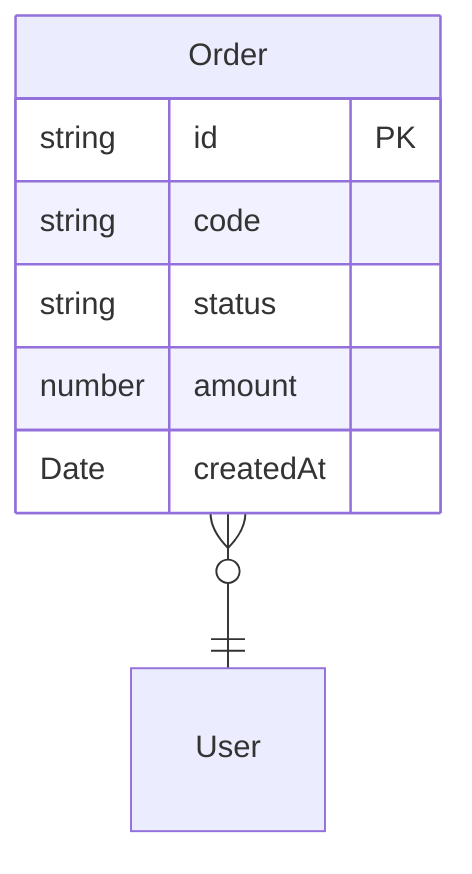

# Business Guide: nestjs-app

> **Được sinh tự động bởi REPO_BUSINESS_DISCOVERY** — Chỉ AI đọc file này, không cần đọc JSON thô  
> Sinh lúc: 2026-07-23T16:35:26.677Z  
> Commit: `1f228d5` | Branch: `main`  
> Nguồn: `/Users/user/QA-skill/qa-run/qa-knowledge/repositories/nestjs-app`

---

## 1. Tổng quan Hệ thống

| Thuộc tính | Giá trị |
|:---|:---|
| Tên repo | nestjs-app |
| Loại | backend |
| Framework | NestJS, TypeORM |
| Ngôn ngữ | JavaScript |
| Số files source | 3 |
| Có TypeScript | Không |
| Có Dockerfile | Không |
| Có CI/CD | Không |
| Có OpenAPI Spec | Không |
| Modules phát hiện | order, user |
| Intergrations | database, queue_event |

---

## 2. Kiến trúc Modules

- **order** — 1 controller, 1 service, 1 entity, integration: database, queue_event

---

## 3. API Contracts (5 endpoints)

| Method | Path | Module | Auth | Roles |
|:---|:---|:---|:---:|:---|
| `GET` | `/orders` | order | 🔒 | PUBLIC |
| `GET` | `/orders/:id` | order | 🔒 | admin, manager |
| `POST` | `/orders` | order | 🔒 | PUBLIC |
| `PUT` | `/orders/:id/approve` | order | 🔒 | PUBLIC |
| `DELETE` | `/orders/:id` | order | 🔒 | admin, manager |

---

## 4. Business Rules (13 rules)

| Rule ID | Category | Condition | Failure Result | Confidence |
|:---|:---|:---|:---|:---:|
| `PERMISSION_BF426B` | permission | @UseGuards(JwtAuthGuard) | Từ chối truy cập / Unauthorized | verified |
| `PERMISSION_203CBC` | permission | @Roles('admin', 'manager') | Từ chối truy cập / Unauthorized | verified |
| `PERMISSION_3B47B5` | permission | @Roles('admin') | Từ chối truy cập / Unauthorized | verified |
| `UNIQUENESS_B1502A` | uniqueness | import { Injectable, NotFoundException, ConflictException, ForbiddenException }  | Từ chối do dữ liệu đã tồn tại | verified |
| `EXISTENCE_CHECK_19AC93` | existence_check | if (!order) throw new NotFoundException('Order not found'); | Trả lỗi 404 / Not Found | verified |
| `STATE_TRANSITION_FEB75D` | state_transition | throw new Error('Cannot approve order not in PENDING status'); | Không hợp lệ — sai trạng thái | verified |
| `PERMISSION_E49BE7` | permission | if (!user.hasPermission('order:approve')) { | Từ chối truy cập / Unauthorized | verified |
| `PERMISSION_483662` | permission | throw new ForbiddenException('Insufficient permission to approve order'); | Từ chối truy cập / Unauthorized | verified |
| `FINANCIAL_483662` | financial | throw new ForbiddenException('Insufficient permission to approve order'); | Từ chối giao dịch do không đủ số dư | verified |
| `STATE_TRANSITION_B5F2AA` | state_transition | if (order.status === OrderStatus.COMPLETED) { | Không hợp lệ — sai trạng thái | verified |
| `UNIQUENESS_4107DF` | uniqueness | throw new ConflictException('Cannot delete completed order'); | Từ chối do dữ liệu đã tồn tại | verified |
| `EXISTENCE_CHECK_1B166C` | existence_check | if (existing) throw new ConflictException('Order code already exists'); | Trả lỗi 404 / Not Found | verified |
| `UNIQUENESS_1B166C` | uniqueness | if (existing) throw new ConflictException('Order code already exists'); | Từ chối do dữ liệu đã tồn tại | verified |

---

## 5. State Machines

**Order**

States: `DRAFT → PENDING → APPROVED → REJECTED → COMPLETED → CANCELLED`

_(transitions chưa rõ)_

---

**order**

States: ``

- `ANY` → `APPROVED`

---

## 6. Business Flows (5 flows)

### GET / (Roles)
- **Module:** order
- **Actor:** Admin
- **Trigger:** `GET `
- **Preconditions:** User phải được xác thực, User phải có quyền thích hợp
- **Side effects:** database_write, database_delete
- **Confidence:** verified

### GET :id (findOne)
- **Module:** order
- **Actor:** Admin
- **Trigger:** `GET :id`
- **Preconditions:** User phải được xác thực, User phải có quyền thích hợp
- **Side effects:** database_write, database_delete
- **Confidence:** verified

### POST / (create)
- **Module:** order
- **Actor:** Admin
- **Trigger:** `POST `
- **Preconditions:** User phải được xác thực, User phải có quyền thích hợp
- **Side effects:** database_write, database_delete
- **Confidence:** verified

### PUT :id/approve (Roles)
- **Module:** order
- **Actor:** Admin
- **Trigger:** `PUT :id/approve`
- **Preconditions:** User phải được xác thực, User phải có quyền thích hợp
- **Side effects:** database_delete
- **Confidence:** verified

### DELETE :id (Roles)
- **Module:** order
- **Actor:** Admin
- **Trigger:** `DELETE :id`
- **Preconditions:** User phải được xác thực, User phải có quyền thích hợp
- **Side effects:** database_delete
- **Confidence:** verified

---

## 7. Permission Matrix

**Roles phát hiện:** admin, manager

**admin** (2 endpoints):  
- `GET /orders/:id`
- `DELETE /orders/:id`

**manager** (2 endpoints):  
- `GET /orders/:id`
- `DELETE /orders/:id`

---

## 8. Domain Model (1 entities)

**Order** (TypeORM)
- `string` id **(PK)**
- `string` code
- `string` status
- `number` amount
- `Date` createdAt

---

## 9. Tích hợp Bên ngoài

- **database**
- **queue_event**

---

## 10. Điểm Quan trọng cho QA

### Business Rules cần test kỹ
- [PERMISSION_BF426B] **permission**: @UseGuards(JwtAuthGuard) → Từ chối truy cập / Unauthorized
- [PERMISSION_203CBC] **permission**: @Roles('admin', 'manager') → Từ chối truy cập / Unauthorized
- [PERMISSION_3B47B5] **permission**: @Roles('admin') → Từ chối truy cập / Unauthorized
- [STATE_TRANSITION_FEB75D] **state_transition**: throw new Error('Cannot approve order not in PENDING status'); → Không hợp lệ — sai trạng thái
- [PERMISSION_E49BE7] **permission**: if (!user.hasPermission('order:approve')) { → Từ chối truy cập / Unauthorized
- [PERMISSION_483662] **permission**: throw new ForbiddenException('Insufficient permission to approve order'); → Từ chối truy cập / Unauthorized
- [FINANCIAL_483662] **financial**: throw new ForbiddenException('Insufficient permission to approve order'); → Từ chối giao dịch do không đủ số dư
- [STATE_TRANSITION_B5F2AA] **state_transition**: if (order.status === OrderStatus.COMPLETED) { → Không hợp lệ — sai trạng thái

### State transitions cần test boundary
- **Order**: Kiểm tra không thể nhảy state bất hợp lệ, rollback khi lỗi
- **order**: Kiểm tra không thể nhảy state bất hợp lệ, rollback khi lỗi

### API cần test auth/permission
- `GET /orders` — yêu cầu roles: authenticated
- `GET /orders/:id` — yêu cầu roles: admin, manager
- `POST /orders` — yêu cầu roles: authenticated
- `PUT /orders/:id/approve` — yêu cầu roles: authenticated
- `DELETE /orders/:id` — yêu cầu roles: admin, manager

---

## 11. Knowledge Gaps & Assumptions

> [!NOTE]
> Các mục dưới đây là **suy luận từ code** (confidence: inferred) — cần con người xác nhận

_Không có gaps đáng kể_

---

## 12. Discovery Session

| | |
|:---|:---|
| Chạy lúc | 2026-07-23T16:11:46.470Z |
| Thời gian | 1.1s |
| Mode | full |
| Commit | 1f228d5 |
| Output dir | `/Users/user/QA-skill/qa-run/qa-knowledge/repositories/nestjs-app` |

---

_Cập nhật lại bằng cách chạy: `node qa-run/scripts/repo-business-discovery.mjs --repo <path> --mode incremental`_
